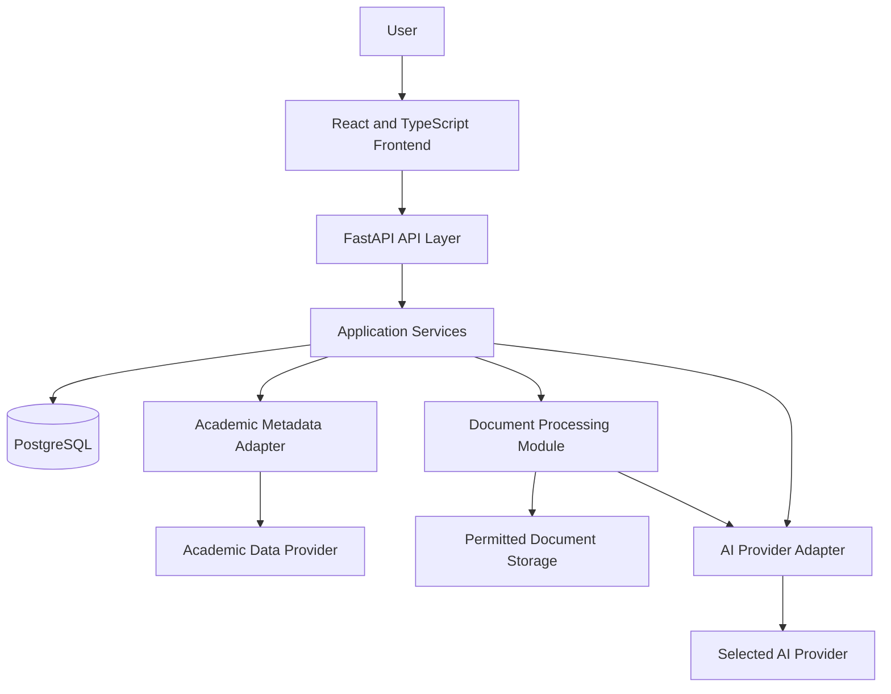

# Research X — System Architecture

**Status:** Proposed architecture
**Version:** 0.1
**Related documents:** `PRODUCT_SPEC.md`, `FEATURE_PLAN.md`, root `AGENTS.md`

---

## 1. Purpose

This document defines the proposed system architecture for Research X.

The architecture should support reliable academic paper discovery, citation exploration, evidence-grounded AI assistance, paper comparison, and persistent research workspaces.

The initial implementation will use a modular application rather than microservices. Components should have clear responsibilities and communicate through documented interfaces.

Technology choices in this document are proposed defaults. They must be validated against the repository, implementation requirements, provider terms, and current official documentation before dependencies are installed.

## 2. Architectural Principles

1. **Modular monolith first:** Keep the backend in one deployable application while maintaining clear module boundaries.
2. **Evidence provenance:** Preserve the origin of academic metadata, citation relationships, and extracted evidence.
3. **Provider isolation:** Keep academic data providers and AI providers behind backend interfaces.
4. **Typed contracts:** Use validated API schemas and consistent frontend types.
5. **Incremental delivery:** Build and test one vertical feature slice at a time.
6. **Security by design:** Validate inputs, protect secrets, enforce resource limits, and respect access permissions.
7. **Operational simplicity:** Avoid specialized infrastructure until real requirements justify it.
8. **Testability:** Core logic should be testable without live external APIs or paid AI requests.

## 3. Proposed Technology Stack

| Layer | Proposed technology | Responsibility |
|---|---|---|
| Frontend | React, TypeScript, Vite | User interface and client-side navigation |
| Styling | Tailwind CSS, with reusable design tokens | Consistent and responsive interface |
| Graph visualization | Cytoscape.js | Interactive paper and citation graph |
| Backend | Python, FastAPI | API, validation, business logic, and integrations |
| API schemas | Pydantic | Request and response validation |
| ORM | SQLAlchemy | Database access and persistence |
| Database migrations | Alembic | Versioned schema changes |
| Database | PostgreSQL | Papers, relationships, workspaces, notes, and metadata |
| Initial academic metadata source | OpenAlex, subject to terms and capability validation | Paper metadata, authors, references, and citation discovery |
| AI integration | One selected model provider behind an adapter | Evidence-grounded explanations and structured extraction |
| Testing | Pytest, frontend test tooling, and browser-based end-to-end tests | Automated verification |
| Version control and CI | Git, GitHub, GitHub Actions | Change management and automated checks |

The exact package versions, frontend test runner, hosting provider, and AI model will be chosen and documented before implementation requires them.

## 4. High-Level System



The frontend communicates with the backend through versioned HTTP APIs.

The backend coordinates business logic, database operations, academic metadata retrieval, document processing, and AI inference.

The frontend must not contain academic-provider credentials, AI-provider secrets, or direct privileged database credentials.

## 5. Frontend Architecture

Organize the frontend by feature rather than placing all components in a single directory.

Proposed structure:

```text
frontend/
├── src/
│   ├── app/
│   ├── components/
│   │   ├── ui/
│   │   └── layout/
│   ├── features/
│   │   ├── search/
│   │   ├── papers/
│   │   ├── graph/
│   │   ├── reader/
│   │   ├── workspace/
│   │   └── compare/
│   ├── services/
│   ├── hooks/
│   ├── lib/
│   ├── types/
│   └── styles/
├── public/
├── tests/
└── package.json
```

Responsibilities:

- `app/`: Application initialization, routing, and top-level configuration.
- `components/ui/`: Reusable interface primitives.
- `components/layout/`: Shared page layouts and navigation.
- `features/`: Feature-specific components, state, and interactions.
- `services/`: Typed API client and HTTP configuration.
- `hooks/`: Reusable React hooks.
- `lib/`: Shared utilities.
- `types/`: Shared frontend type definitions.
- `styles/`: Global styles and design tokens.

Feature modules should not duplicate API clients or silently redefine shared schemas.

## 6. Backend Architecture

Proposed structure:

```text
backend/
├── app/
│   ├── main.py
│   ├── api/
│   │   └── v1/
│   ├── core/
│   ├── models/
│   ├── schemas/
│   ├── repositories/
│   ├── services/
│   ├── integrations/
│   ├── graph/
│   └── documents/
├── migrations/
├── tests/
│   ├── unit/
│   ├── integration/
│   └── fixtures/
└── requirements.txt
```

The initial skeleton uses a pinned `requirements.txt` for backend dependencies. Database, migration, and feature-specific modules will be added when their requirements are implemented.

Responsibilities:

- `api/v1/`: HTTP routes and request handling.
- `core/`: Configuration, logging, security utilities, and shared application setup.
- `models/`: Database models.
- `schemas/`: Validated request and response schemas.
- `repositories/`: Database queries and persistence.
- `services/`: Application-level workflows and business rules.
- `integrations/`: Academic data and AI provider adapters.
- `graph/`: Graph construction, traversal, and relationship handling.
- `documents/`: Document ingestion, extraction, chunking, and retrieval.
- `migrations/`: Version-controlled database schema changes.
- `tests/`: Automated tests.

Keep route handlers thin. Business logic belongs in services, and database operations should follow consistent repository and transaction conventions.

## 7. API Design

Use the `/api/v1` prefix for the initial public API.

Proposed endpoints:

| Method | Endpoint | Purpose |
|---|---|---|
| GET | `/api/v1/health` | Application health check |
| GET | `/api/v1/papers/search` | Search academic papers |
| GET | `/api/v1/papers/{paper_id}` | Retrieve paper details |
| GET | `/api/v1/papers/{paper_id}/references` | Retrieve referenced works |
| GET | `/api/v1/papers/{paper_id}/citations` | Retrieve citing works |
| GET | `/api/v1/graph/{paper_id}` | Retrieve a bounded graph neighborhood |
| POST | `/api/v1/reader/{paper_id}/questions` | Ask an evidence-grounded question |
| POST | `/api/v1/workspaces` | Create a workspace |
| GET | `/api/v1/workspaces` | List the current user's workspaces |
| GET | `/api/v1/workspaces/{workspace_id}` | Retrieve a workspace |
| POST | `/api/v1/workspaces/{workspace_id}/papers` | Save a paper to a workspace |
| DELETE | `/api/v1/workspaces/{workspace_id}/papers/{paper_id}` | Remove a saved paper from a workspace |
| POST | `/api/v1/workspaces/{workspace_id}/notes` | Create a workspace note |
| POST | `/api/v1/compare` | Compare selected papers |

These endpoints are a starting proposal. Request and response fields, pagination, error codes, authentication, and rate limits will be specified in `API_SPEC.md` before implementation.

Paper IDs exposed through the API should use stable application identifiers. External identifiers should be stored separately with their provider namespace.

## 8. Academic Data Integration

Use an adapter for the selected academic metadata provider.

The adapter should:

1. Accept a normalized search or paper lookup request.
2. Call the provider using documented parameters and limits.
3. Validate the response.
4. Normalize available metadata.
5. Preserve external identifiers and provenance.
6. Handle rate limits, timeouts, and unavailable records.
7. Return consistent application-level results.

Provider-specific response fields must not leak throughout the frontend or unrelated backend modules.

OpenAlex is implemented as the initial metadata search adapter for Milestone 3. This implementation uses its Works search endpoint and normalizes only the fields present in each response. The provider-selection decision remains open until coverage, usage terms, supported fields, reference availability, costs, and rate limits are evaluated. Provider keys are optional, backend-only environment settings.

Do not assume every record has an abstract, DOI, reference list, full text, or complete author metadata.

## 9. Citation Graph Architecture

The graph is derived from normalized paper records and relationship data.

Each node represents an identifiable publication.

Each edge must identify its relationship type and available provenance.

Initial relationship types:

- `CITES`: A bibliographic citation relationship supported by source metadata.
- `SIMILAR_TO`: A similarity relationship calculated from content or metadata.
- `INFERRED_RELATED_TO`: A proposed relationship generated by an algorithm or AI model.

The graph service should support bounded expansion, deduplication, stable node identifiers, and appropriate limits.

Citations and inferred relationships must not be treated as equivalent.

A dedicated graph database is not required initially. PostgreSQL can store paper records and explicit relationships while application-level algorithms handle the first graph workflows.

## 10. Evidence-Grounded Reader Architecture

The reader should use a controlled retrieval workflow:

1. Identify the paper and the content available to the system.
2. Retrieve or ingest permitted source material.
3. Extract text while preserving page or section locations when available.
4. Split the text into manageable passages.
5. Retrieve passages relevant to the user's question.
6. Generate an answer from the retrieved evidence.
7. Associate claims with supporting passages where possible.
8. Validate and return the answer with limitations and source references.

The implementation must distinguish abstract-only, partial-text, and full-text access.

Document extraction and retrieval should be isolated from the API layer and AI provider.

Vector embeddings and a vector index may be introduced when the reader's retrieval requirements justify them. The final approach will be documented in `AI_AND_EVIDENCE.md`.

## 11. Database and Persistence

PostgreSQL is the proposed primary database.

The schema should support:

- Normalized papers and external identifiers.
- Authors and paper-author relationships.
- Explicit paper relationships.
- Available paper sections and evidence passages.
- Workspace ownership.
- Saved papers and reading status.
- Notes and collections.
- Optional reading paths.

Schema details, constraints, indexes, provenance fields, and migrations will be defined in `DATA_MODEL.md`.

Use Alembic for versioned schema changes. Do not rely on destructive schema creation or automatic production schema synchronization.

## 12. Error Handling and Observability

The application should provide:

- Consistent API error responses.
- Request validation.
- Timeouts and sensible failure handling for external services.
- Structured application logs.
- Request correlation identifiers where appropriate.
- Usage and latency tracking for expensive AI and document operations.
- Health checks that distinguish application availability from optional provider availability.

Logs must not expose credentials, private notes, or unnecessary document content.

## 13. Security Boundaries

- Keep secrets in backend environment configuration or approved secret management.
- Configure allowed frontend origins explicitly.
- Validate API inputs and uploaded files.
- Apply request and resource limits.
- Prevent unauthorized workspace and note access.
- Protect external document retrieval against unsafe URLs and SSRF.
- Respect copyright, licenses, and provider access restrictions.
- Document retention and deletion behavior.
- Avoid sending unnecessary private content to external AI services.

Authentication and authorization details must be finalized before exposing user-specific workspaces.

## 14. Deployment Strategy

The initial deployment should favor a small number of managed services:

- One frontend deployment.
- One backend deployment.
- One managed PostgreSQL database.
- A document-storage service only if required.

The exact providers will be selected later based on pricing, regional availability, operational simplicity, and project requirements.

Deployment configuration, environment variables, migrations, backups, monitoring, and rollback procedures will be documented in `DEPLOYMENT_AND_OPERATIONS.md`.

## 15. Architecture Decision Process

Major decisions should be recorded in `DECISIONS.md` or separate architecture decision records.

Each decision should describe:

- Context and problem.
- Chosen option.
- Alternatives considered.
- Trade-offs.
- Security and cost implications.
- Conditions that would justify revisiting the decision.

Do not add infrastructure merely because it is popular or technically interesting.

## 16. Implementation Sequence

1. Finalize technical documentation and decisions.
2. Establish repository conventions and automated checks.
3. Build the frontend and backend skeleton.
4. Add the database and migrations.
5. Integrate academic paper search.
6. Build paper details and citation navigation.
7. Add evidence-grounded reading.
8. Add workspaces and notes.
9. Add paper comparison.
10. Evaluate advanced graph and research-intelligence capabilities.
11. Complete security, reliability, testing, and deployment work.

Each phase must have documented acceptance criteria before it begins.

---

**End of System Architecture**
